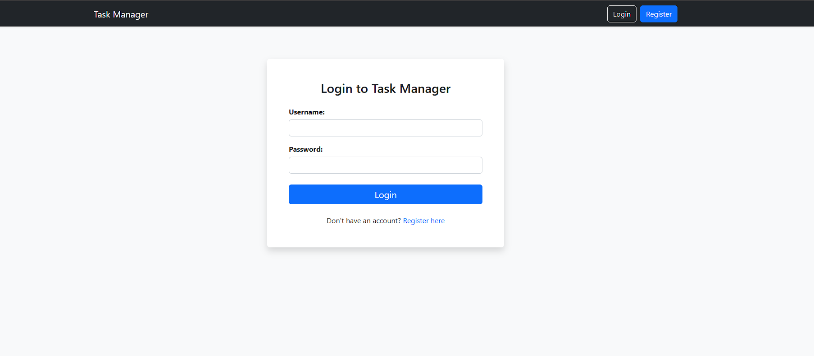
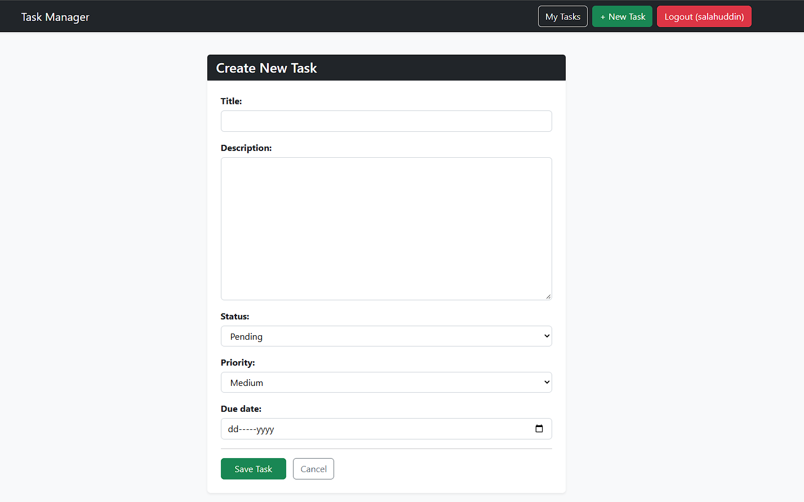
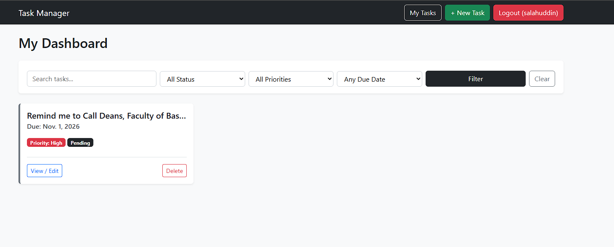

# Task Management System (Django)

## Objective
A fully functional Task Management System built with Django. It features user authentication, user-specific data isolation, task CRUD operations, and advanced filtering/searching capabilities.

## Setup Instructions
1. Clone the repository.
2. Create and activate a virtual environment: `python -m venv env` & `env\Scripts\activate` (Windows).
3. Install dependencies: `pip install django`
4. Run migrations: `python manage.py migrate`
5. Run the server: `python manage.py runserver`
6. Access the app at `http://127.0.0.1:8000/tasks/`

## Problem Statement
The goal was to build a system where users can register, log in, and manage their own tasks. Users should not be able to view or edit tasks created by others. The application required robust filtering (by status, priority, due date), searching by title/description, and sorting functionality.

## Features
- **User Authentication:** Registration, Login, Logout.
- **Authorization:** Only owners can view, edit, or delete their tasks.
- **Task CRUD:** Create, Read, Update, Delete tasks.
- **Search & Filter:** Filter tasks by Status, Priority, Due Date, and Search by Title/Description.

## Screenshots

